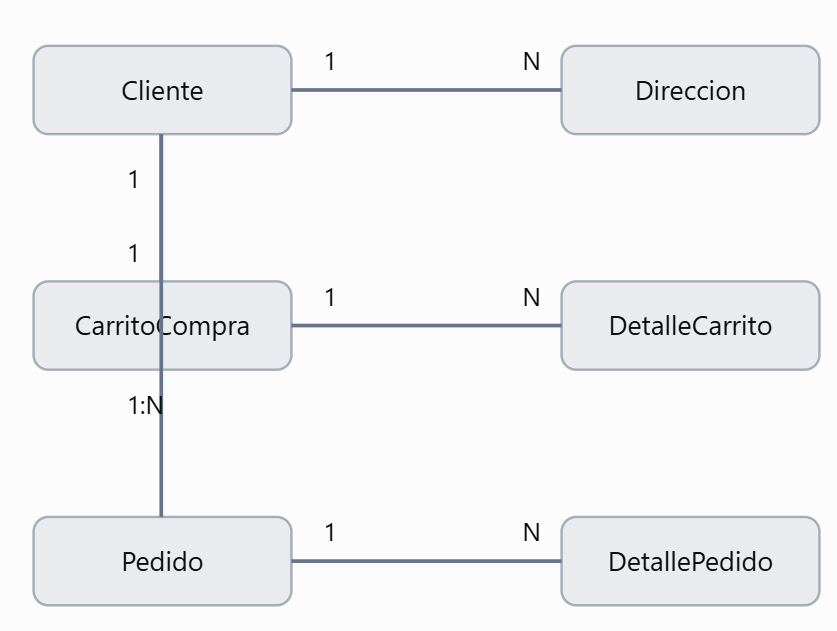

# web-store
Modelos: convertir nuestras clases en tablas MySQL
En la versión anterior utilizábamos @dataclass. Ahora definiremos entidades ORM mediante SQLAlchemy.

Las relaciones serán:
Además, cada DetalleCarrito y DetallePedido referencia un Producto. El Pedido referencia la Dirección utilizada en la compra.